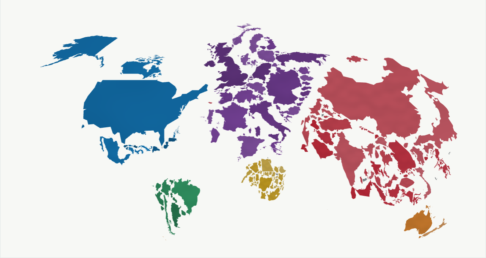

# Country Cartogram

Make country cartograms from CSV data. Each country's area represents its value.
Export PNG, SVG, or PDF, or generate an interactive HTML time series.

[](docs/gallery/gdp-1985-2024.html)

## Make a map

Requires Python 3.10+. Run these commands from the repository root:

```bash
python -m venv .venv
source .venv/bin/activate
python -m pip install -e .
country-cartogram examples/gdp.csv --config examples/gdp.json --out output/gdp
```

Open `output/gdp.png`, `output/gdp.svg`, or `output/gdp.pdf`.
See the [GDP](docs/gallery/gdp.png), [population](docs/gallery/population.png),
and [growth animation](docs/gallery/gdp.growth.gif) examples.

## Use your own data

Create `values.csv` with country codes and quantities:

```csv
country_code,value
FRA,42
DEU,60
ITA,35
```

```bash
country-cartogram values.csv --out output/my_map
```

Use codes from the [country catalog](src/country_cartogram/data/country_catalog.csv).
Values must be finite and non-negative. Zero values are omitted.
Optional `name`, `cluster`, and `parent` columns set names, groups, and parent links.
See [usage](docs/usage.md) for colors, titles, labels, and other settings.

## 40 years of GDP

```bash
country-cartogram-timeline examples/gdp-1985-2024.csv \
  --config examples/gdp-1985-2024.json --normalization shares \
  --viewer-only --out output/gdp-1985-2024
```

Open `output/gdp-1985-2024/timeline.html`, or download the
[ready-made HTML](docs/gallery/gdp-1985-2024.html). It works offline.

The map follows 209 economies from 1985 to 2024. Area shows each economy's share
of the included GDP, measured in constant 2015 US dollars. Countries keep the
same outlines and move continuously from their previous positions.
Missing annual values are filled **before simulation** and shown in grey.
Use Play, the year selector, or the slider to explore.
See [time series](docs/time-series.md) for your own data.

To serve the example locally, run this from the repository root and keep it running:

```bash
python -m http.server 8765 --bind 127.0.0.1
```

Then open [the local GDP timeline](http://127.0.0.1:8765/docs/gallery/gdp-1985-2024.html).

## Reuse a map

Keep the `.layout.json`, `.audit.json`, and `.metrics.csv` files together.
They contain the saved shapes, settings, values, and numerical checks.

- [Restyle](docs/usage.md#reuse-a-saved-layout) to change colors or labels without rerunning the simulation.
- [Continue a layout](docs/time-series.md#continue-from-a-checkpoint) with new quantities, starting from its previous positions.
- [Use Python](docs/usage.md#use-from-python) to call the same functions as the commands.

Choose a new output name to keep earlier results; commands overwrite matching files.

## Experimental 3D

With two quantities, area shows the first, height shows second ÷ first, and
volume shows the second. Small countries with high ratios can form tall columns
that are hard to compare. The viewer includes transparency, a top view, and a values table.

See the [3D guide](docs/3d.md) and [3D timeline example](docs/gallery/population-gdp-timeline.html).

## Details and sources

Shapes are simplified before simulation with a default 2% shape error budget.
Their areas are restored to preserve the input proportions.
See [the algorithm](docs/algorithm.md) and [development guide](CONTRIBUTING.md).
For national or fantasy maps and other projections, see [other base maps](docs/usage.md#other-base-maps).

Static examples use historical Natural Earth values; population timelines use
synthetic growth. The GDP timeline uses World Bank observations and marked estimates:
[data provenance](examples/gdp-1985-2024.provenance.json).

Code and Three.js: [MIT](LICENSE). Natural Earth: public domain
([source metadata](src/country_cartogram/data/sources.json)).
World Bank GDP: [CC BY 4.0](https://data.worldbank.org/indicator/NY.GDP.MKTP.KD).
