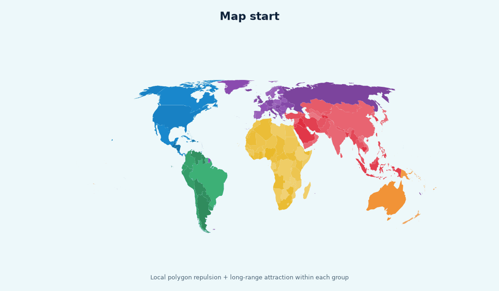
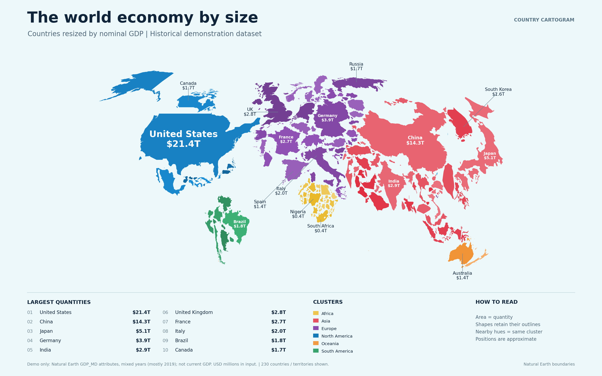
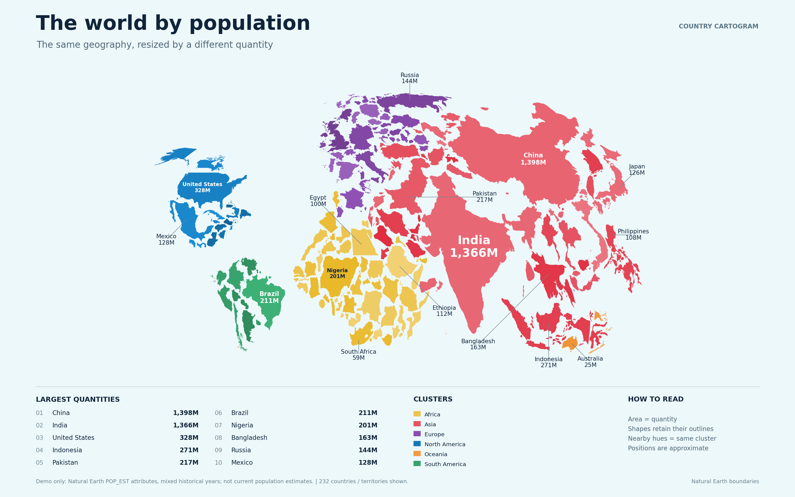

# Country Cartogram

Turn a CSV of country quantities into a separated, shape-preserving world map.
Countries start at their geographic positions, gradually grow or shrink, and
settle under local repulsion and continuous attraction within each cluster.



The animation is captured from actual solver states. The example quantities are
historical Natural Earth attributes, not current GDP estimates.

## What is included

- **Gradual geographic growth:** interpolate areas, with linear dimensions
  changing by the square root of the area ratio.
- **Two geometry resolutions:** conservative convex collision shapes for speed,
  finer country outlines for the exported figure.
- **Cluster attraction:** value-weighted moving barycenters, geographic anchors,
  and stable color variations within each continent or custom group.
- **Islands and territories:** compact remote parts while approximately retaining
  direction; optional parent links for separately quantified territories.
- **Audited output:** validate real polygons for overlaps, minimum gaps, and
  proportional areas before exporting PNG, SVG, PDF, coordinates, and metrics.
- **Reproducible examples:** bundled geography, GDP and population CSVs, an
  animation exporter, a restyling command, tests, and GitHub Actions workflows.

## Quick start

Requires Python 3.10 or later. From the repository root:

```bash
python -m venv .venv
source .venv/bin/activate
# Windows PowerShell: .venv\Scripts\Activate.ps1
python -m pip install -e .

country-cartogram examples/gdp.csv --config examples/gdp.json --out output/gdp --animate
country-cartogram examples/population.csv --config examples/population.json --out output/population
```

`python -m country_cartogram` is equivalent to `country-cartogram`. Once the
dependencies are installed, the pipeline works offline. Generated outputs stay
in the ignored `output/` directory; selected previews are kept in `docs/gallery/`.

## Use your own data

Create `my_values.csv` with the two required columns:

```csv
country_code,value
FRA,42
DEU,60
ITA,35
ESP,30
```

```bash
country-cartogram my_values.csv --out output/my_map
```

The values above are illustrative. Optional columns are `name`, `cluster`, and
`parent`. Use the [country catalog](src/country_cartogram/data/country_catalog.csv)
for accepted codes and [the blank template](examples/your_values.csv) to prepare
a larger dataset. Delete unused template rows: blank quantities are rejected.
Zero means zero area; missing rows are recorded separately.

Copy [config.example.json](config.example.json), or supply a JSON file containing
only overrides. The most useful controls are `country_gap`, `cluster_pull`,
`geographic_pull`, `growth_steps`, `relax_per_step`, `satellite_distance`, and
`colors`. [The usage guide](docs/usage.md) describes every setting and output.

Python API:

```python
from pathlib import Path
from country_cartogram.pipeline import run

report = run(
    Path("my_values.csv"),
    output=Path("output/my_map"),
    formats=("svg", "png"),
)
print(report["minimum_country_distance"])
```

## Examples and checks





| Included example | Countries / territories | Overlapping pairs | Minimum gap | Maximum relative area error |
| --- | ---: | ---: | ---: | ---: |
| GDP | 230 | 0 | 0.4190 | 6.63e-14 |
| Population | 232 | 0 | 0.4190 | 2.35e-13 |

Both reached the configured settling tolerance. These are observed results for
the included datasets; arbitrary inputs can need different force settings or
more settling time. The corresponding audits are in [docs/gallery](docs/gallery).

## How it works

The [algorithm notes](docs/algorithm.md) explain the area schedule, forces,
satellite handling, collision approximation, and the design choices that mattered
in practice. A separate [development guide](CONTRIBUTING.md) covers tests and
reproducing the examples.

| Module | Responsibility |
| --- | --- |
| `geometry.py` | Projection, outline simplification, islands, legacy packer |
| `progressive.py` | Continuous intermediate geometry from geographic to target sizes |
| `physics.py` | Rigid bodies, local contacts, cluster and geographic forces, settling |
| `pipeline.py` | CSV validation, orchestration, independent geometry audit, rendering |
| `evolution.py` | GIF and three-stage overview from solver frames |
| `restyle.py` | Change presentation without recomputing the layout |

These modules live in `src/country_cartogram/`.

## Limits and provenance

This is an experimental non-contiguous cartogram layout, not a geographical map
or a globally optimal packing algorithm. Positions and neighbor relationships
may change. The default collision hulls can leave extra space near concave
coasts. The exported outlines use uniform scaling and translation; additional
elastic deformation is a possible extension, not an implemented feature.

Geography is bundled from Natural Earth 1:50m, release tag v5.1.2, with
[source metadata and checksum](src/country_cartogram/data/sources.json).
Natural Earth data is public domain. Historical example years vary by row;
replace them with a consistent, sourced dataset for substantive analysis.
Boundary and territory conventions follow the source dataset.

Code: [MIT license](LICENSE). No online cartogram service is required.
